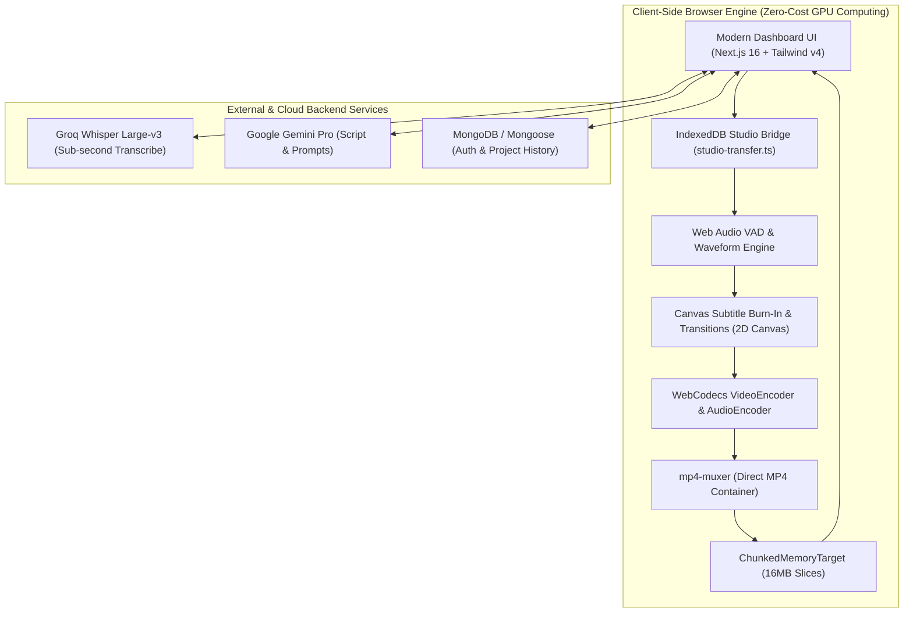
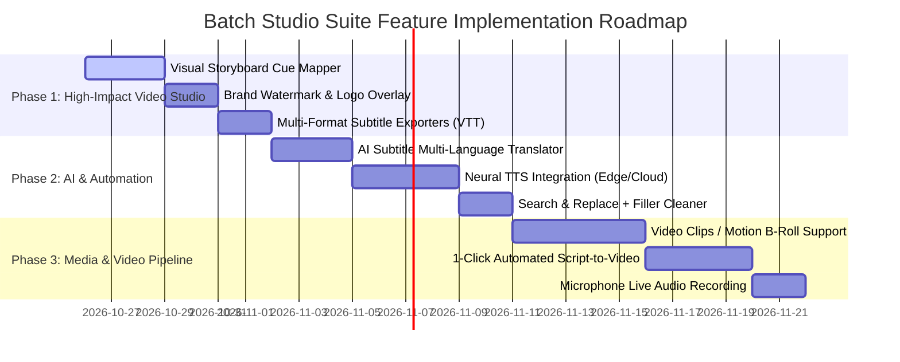

# 🚀 Batch Studio Suite — Deep Architecture Analysis & Feature Roadmap

---

## Executive Summary

**Batch Studio Suite (by JC Design)** has a rare and powerful architectural foundation: **client-side, hardware-accelerated video rendering via WebCodecs**, integrated with cloud AI speech-to-text (Groq Whisper Large-v3), waveform-level subtitle alignment (Web Audio VAD), and cross-tool IndexedDB data pipelines.

By running the compute-heavy rendering (2K MP4 muxing, animated subtitle burn-in, audio ducking, canvas motion transitions) **entirely inside the user's browser GPU**, the platform eliminates server-side rendering costs (AWS EC2 / GPU clusters) while delivering sub-minute export speeds.

This document presents a comprehensive feature audit of the existing codebase, identifies critical capability gaps, and provides an actionable, phased implementation roadmap to evolve the suite into a complete, market-leading automated content studio (competing with CapCut, Descript, and Opus Clip).

---

## 1. Current State & Architecture Audit



### Module Breakdown & Strengths

| Module | Core Strengths | Current Technical Bottlenecks |
| :--- | :--- | :--- |
| **Video Generator** (`/dashboard/video-editor`) | • Hardware 2K/1080p WebCodecs GPU encoding<br>• Real-time 3-frame hardware probe & auto-downgrade<br>• Dynamic transitions & auto-synced SFX<br>• Hormozi bouncing karaoke subtitle burn-in | • Only accepts **still images** (no MP4/WebM video clips or motion backgrounds)<br>• Cues map to images linearly via modulo (`cueIdx % images.length`); no visual manual assignment grid<br>• No custom watermark/logo overlay |
| **Subtitle Studio** (`/dashboard/subtitle-sync-editor`) | • Frame-precise waveform visualizer<br>• Needle splitting (`S`), drag-to-resize cue handles<br>• Word-level karaoke nudging (`-50ms`/`+50ms`)<br>• Multi-track Lo-Fi synth with automated speech ducking | • Only exports `.srt` (no `.vtt`, `.ass`, or social media caption formats)<br>• No multi-language translation<br>• No global search & replace for misheard words across all cues |
| **AI Transcriber** (`/dashboard/transcribe`) | • Sub-second Groq Whisper Large-v3 cloud inference<br>• Word-by-word vs. Sentence grouping modes<br>• 1-click IndexedDB bridges into Subtitle Studio & Video Editor | • Requires manual audio file upload (no YouTube/TikTok URL or direct microphone capture)<br>• Single-file processing only (no batch transcription queue) |
| **Audio & Voice Studio** (`/dashboard/audio-studio`) | • Word count & speech duration estimator<br>• Script presets & 4 persona presets | • Uses browser `speechSynthesis` / synthetic Web Audio formant buzzy tones (lacks realistic Neural AI voices like Edge TTS or ElevenLabs)<br>• No audio crop/trim handles |
| **Image Generator** (`/dashboard/image-generator`) | • FLUX.1 & Gemini Pro models<br>• 2K canvas upscaler with edge sharpening | • Generates standalone images; cannot auto-read an SRT/script and generate an entire consistent storyboard in 1 click |

---

## 2. Recommended Features to Implement

### Category A: Core Video Engine Upgrades (Highest Value)

#### 1. Video Clips & Motion Background Support (B-Roll Video in Video Generator)
* **What it does:** Allows users to upload or attach short video clips (`.mp4`, `.webm`, `.mov`) or looping background motion graphics in addition to still images.
* **Why it matters:** Still-image storyboards can feel static. Mixing animated doodle loops, cinematic video clips, and live-action B-roll makes the exported videos look like high-production YouTube/TikTok content.
* **How to build:** Use `<video>` elements rendered onto the existing `encodeCanvas` using `video.currentTime = (frameIdx / fps) % video.duration`. WebCodecs effortlessly encodes from `<video>` canvas draws.

#### 2. Visual Storyboard Grid & Drag-and-Drop Cue-to-Asset Mapper
* **What it does:** A visual scene sequencer where each subtitle cue is displayed alongside its assigned image/video card.
* **Capabilities:**
  - Drag-and-drop to reorder images across cues.
  - "Lock Asset to Cue" toggle so a specific image always accompanies a specific scene.
  - Multi-cue image spanning (allow 1 hero image to remain active across 3 rapid subtitle cues).

#### 3. Custom Brand Watermark, Logo & Intro/Outro Bumper Cards
* **What it does:** Allows users to upload a transparent PNG logo, set placement (Top-Right, Top-Left, Bottom-Right) with opacity slider, and optionally append a 3-second animated intro/outro branding slide.

---

### Category B: End-to-End Automation & AI Features

#### 4. "1-Click Full Automation Pipeline" (Script $\to$ Final Video)
* **What it does:** Eliminates manual tool jumping by creating a unified automated wizard:
  1. **Prompt/Topic $\to$ Script:** Gemini Pro writes a viral 30-second or 60-second video script with voiceover and visual prompts.
  2. **Script $\to$ Voiceover:** Automatically synthesizes voice narration.
  3. **Voiceover $\to$ Subtitles:** Automatically generates word-synced subtitles via Groq Whisper.
  4. **Subtitles $\to$ AI Storyboard:** Automatically generates consistent storyboard images for every scene via Image Studio.
  5. **Auto-Assemble:** Injects all assets into Video Generator for a single-click 2K export.

#### 5. Multi-Language AI Subtitle Translator
* **What it does:** Instantly translates all cues into 40+ languages (Spanish, German, Japanese, Portuguese, Hindi, French, etc.) using Gemini API with 1 click.
* **Output:** Generates translated `.srt` files and allows rendering the video with foreign-language subtitles for international reach.

#### 6. Global Subtitle "Search & Replace" & Profanity/Filler Cleaner
* **What it does:**
  - Fast search & replace tool across all 200+ cues (fixing misspelled names, brand names, or homophones).
  - One-click "Clean Fillers" button that auto-detects and removes "um", "uh", "you know", and trims cue boundaries accordingly.

---

### Category C: Audio & Voice Studio Enhancements

#### 7. Neural AI Voice Generation (Edge TTS / ElevenLabs API)
* **What it does:** Integrates high-fidelity, studio-quality neural voices.
* **Option A (Zero-Cost):** Edge TTS provides hundreds of crystal-clear neural voices (English, UK, Australian, etc.) completely free with natural inflection and breathing.
* **Option B (Premium API Key):** Allow users to input their own ElevenLabs API key for hyper-realistic voice cloning and emotional delivery.

#### 8. Direct YouTube / Audio URL & Microphone Ingestion
* **What it does:** In the Transcriber and Subtitle Studio:
  - Add a "Paste Video URL" tab to transcribe directly from online audio/video.
  - Add a "Record Microphone" button with real-time waveform monitor so creators can speak directly into the browser and transcribe on the fly.

---

### Category D: Cloud Persistence & Export Formats

#### 9. Full Project Cloud Save & Reload (MongoDB + Local IndexedDB)
* **What it does:** Currently, session data is stored in memory and temporary IndexedDB. Add a "Save Project" modal that persists:
  - SRT cues, word timings, assigned images, audio buffer, and video settings.
  - Allows reopening past projects from `/dashboard/overview` or the Projects modal and picking up editing seamlessly.

#### 10. Multi-Format Caption & Video Exporter
* **Subtitle formats:** Export to `.vtt` (WebVTT for web players), `.ass` (Advanced SubStation Alpha with custom styling), and `.json`.
* **Video formats:** Export MP4, WebM (faster for web), GIF (for email/previews), and Audio-only (`.wav`/`.mp3`).

---

## 3. Prioritized Implementation Roadmap



### Phase Breakdown

| Phase | Milestone | Features Included | Effort | Impact |
| :---: | :--- | :--- | :---: | :---: |
| **Phase 1** | **Studio Ergonomics & Polish** | • **Visual Storyboard Cue Mapper:** Drag, drop, and link specific images to specific cues.<br>• **Brand Logo / Watermark:** Add customizable logo onto video canvas.<br>• **Multi-Format Subtitle Export:** Export `.vtt`, `.ass`, `.txt`, `.srt`. | 1 Week | 🔥 High |
| **Phase 2** | **AI Language & Voice Power** | • **AI Subtitle Translator:** 1-click translation into 40+ languages via Gemini.<br>• **Neural AI Voice Generator:** Natural human voices replacing formant buzzer.<br>• **Find & Replace:** Batch fix words across 100+ cues. | 1.5 Weeks | 🔥🔥 Very High |
| **Phase 3** | **Pro Video Engine & Automation** | • **Video Clips / Motion Backgrounds:** Allow `.mp4`/`.webm` B-roll loops on canvas.<br>• **1-Click Script-to-Video Generator:** Complete topic $\to$ script $\to$ voice $\to$ visuals $\to$ 2K video.<br>• **Mic Recording & URL Import:** Direct browser voice capture. | 2 Weeks | 🚀 Game Changer |

---

## 4. Architectural Implementation Blueprint for Phase 1

### Feature 1.1: Storyboard Cue Mapper (Data Contract)

Add `assignedCueIndices?: number[]` to images and `assignedImageIndex?: number` to `Cue`:

```typescript
// In src/lib/video-generator/types.ts
export interface StoryboardItem {
  id: string;
  image: HTMLImageElement;
  fileName: string;
  assignedCueIndex: number; // Exactly which cue this image belongs to
  customDurationSec?: number;
}
```

In [useVideoGenerator.ts](file:///c:/Users/ismai/OneDrive/Desktop/Projects/Tools/batch-studio-video-editor/src/hooks/useVideoGenerator.ts):
```typescript
// Look up image assigned to this specific cue, or fall back to linear index
const currentAsset = storyboardMap.get(currentCueIdx) ?? loadedImages[currentCueIdx % loadedImages.length];
drawFitImage(ctx, currentAsset, aspectW, aspectH, zoom, 0, 0);
```

### Feature 1.2: Brand Logo & Watermark Overlay

In [VideoSettingsCard.tsx](file:///c:/Users/ismai/OneDrive/Desktop/Projects/Tools/batch-studio-video-editor/src/components/studio/VideoSettingsCard.tsx) and [useVideoGenerator.ts](file:///c:/Users/ismai/OneDrive/Desktop/Projects/Tools/batch-studio-video-editor/src/hooks/useVideoGenerator.ts):
```typescript
if (settings.watermarkImage) {
  const logoW = aspectW * 0.12; // 12% width
  const logoH = logoW * (settings.watermarkImage.height / settings.watermarkImage.width);
  const margin = 32;
  
  ctx.save();
  ctx.globalAlpha = settings.watermarkOpacity ?? 0.85;
  // Position: top-right
  ctx.drawImage(settings.watermarkImage, aspectW - logoW - margin, margin, logoW, logoH);
  ctx.restore();
}
```

---

## 5. Next Steps & Decision Matrix

1. **Which feature would provide immediate value for your current workflow?**
   - **Option A:** The **Visual Storyboard Cue Mapper & Brand Watermark** (enhances video quality and control immediately).
   - **Option B:** **Neural AI Text-to-Speech** (replaces synthetic voices with broadcast-quality natural human narration).
   - **Option C:** **Multi-Language Subtitle Translator** (instantly repurposes videos for global audiences).
   - **Option D:** The **1-Click Automated Script-to-Video Pipeline** (turns raw topics into complete videos automatically).
